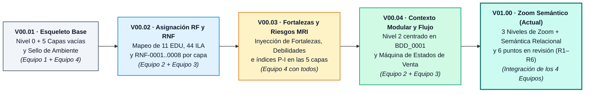
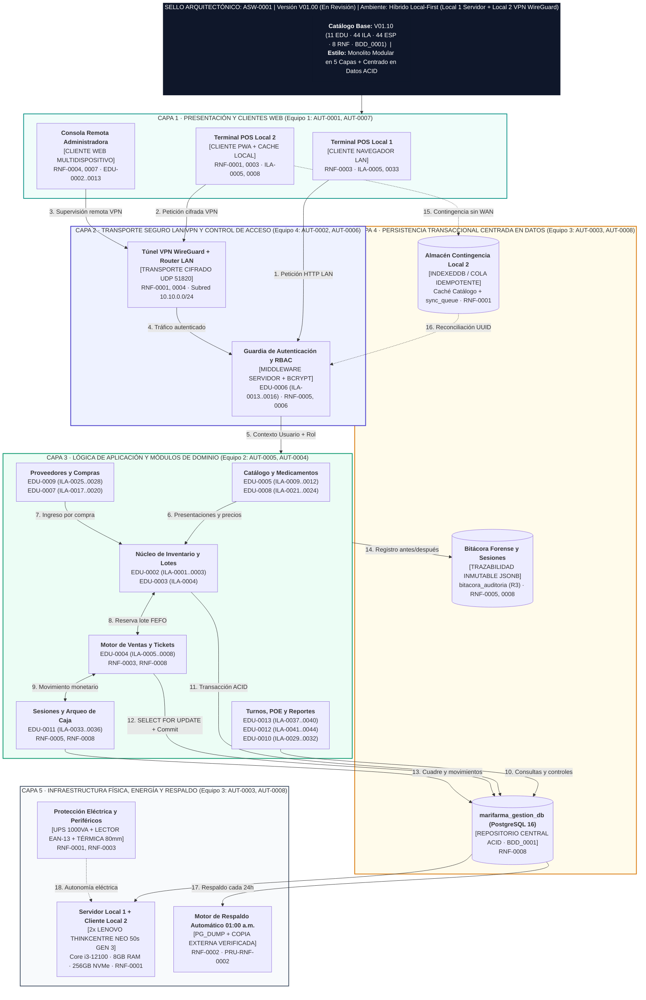
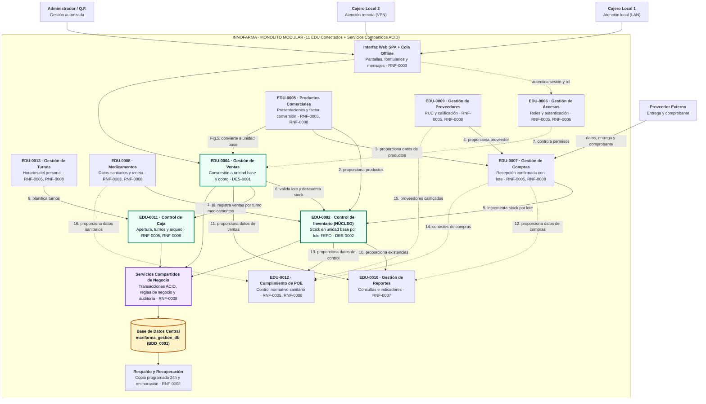
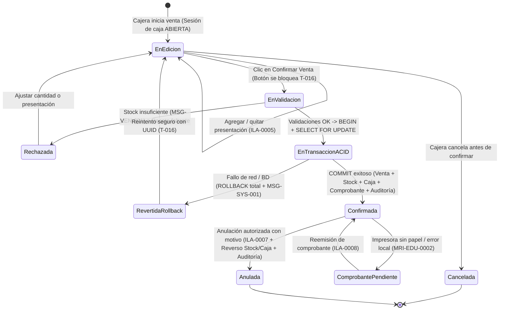
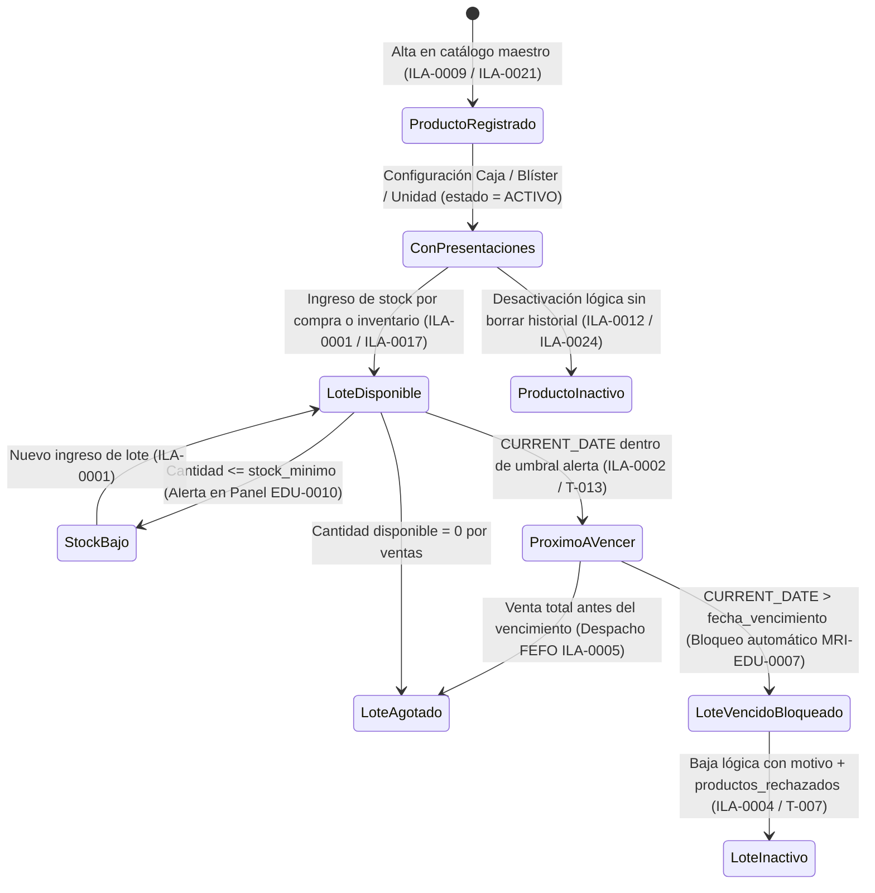

# RESUMEN Y EVOLUCIÓN DE LA ARQUITECTURA DE SOFTWARE (`ASW-0001`)

**Proyecto:** Sistema de Gestión Farmacéutica y Control de Inventario — **Innofarma**  
**Cliente:** Botica Marifarma (Sede Principal Local 1 y Sede Secundaria Local 2 — Arequipa)  
**Curso:** Diseño y Arquitectura de Software (UNSA — EPIS — Semestre 2026-B)  
**Código del Artefacto:** `ASW-0001` | **Versión Actual:** `V01.00 (Avance Consolidado con Puntos en Revisión)`  
**Ambiente de Trabajo:** *Ambiente Operativo Híbrido Local-First (Local 1: Servidor Central + Cliente LAN | Local 2: Cliente Remoto vía VPN WireGuard + Caché Local)*  
**Catálogo Base:** `Catálogo de Requisitos V01.10` (`11 EDU` · `44 ILA` · `44 ESP` · `8 RNF` · `BDD_0001` · `Matrices MRI`)

🌐 **[Abrir Visor Interactivo en Vivo (GitHub Pages)](https://jperezh04.github.io/innofarma-arquitectura/)**
- **[0.1 Arquitectura en 5 Capas (CR → RF/RNF/Riesgos)](https://jperezh04.github.io/innofarma-arquitectura/#fig0_1_asw_capas_definitiva.html)**
- **[0.2 Contexto Modular Nivel 2 (11 EDU Conectados)](https://jperezh04.github.io/innofarma-arquitectura/#fig0_2_asw_contexto_modular_zoom.html)**
- **[0.3 Contexto Global Nivel 0 + Máquinas de Estados](https://jperezh04.github.io/innofarma-arquitectura/#fig0_3_asw_contexto_global_n0.html)**

---

## 1. Propósito de este Documento

Este documento explica **de qué trata cada parte de la Arquitectura de Software (`ASW-0001`)** de Innofarma, cómo responde directamente a la fórmula exigida en cátedra:

$$\text{Catálogo de Requisitos (CR)} \longrightarrow \text{Arquitectura Final (ASW-0001)} \longrightarrow \{ \text{RF (EDU / ILA / ESP)},\ \text{RNF},\ \text{Riesgos (Fortalezas y Debilidades)} \}$$

Además, documenta:
1. **La repartición del trabajo en 4 equipos de 2 integrantes (`AUT-0001` a `AUT-0008`)**, alineada con las actividades previas de cada miembro.
2. **La evolución progresiva del diagrama (`V00.01` $\rightarrow$ `V01.00`)**, desde el esqueleto inicial hasta el modelo con **Zoom Semántico de 3 Niveles (`1. Lejos Esqueleto` / `2. Medio Píldoras CR` / `3. Cerca Detalle Total`)**.
3. **El significado técnico y funcional de cada capa y cada módulo**, escrito para que tanto el equipo de exposición como un equipo de desarrollo de software comprendan qué construye cada bloque.
4. **Los 6 puntos que se mantienen "En Revisión" (`R1` a `R6`)**, indicando cuáles requerirán un ajuste puntual en el `Catálogo de Requisitos V01.10` en la siguiente iteración.

---

## 2. Repartición del Trabajo en 4 Equipos de 2 Integrantes

La arquitectura se dividió en **4 frentes complementarios**, asignando cada pareja según las tareas que ya lideraron en `Control de actividades por semana.xlsx`:

| Equipo | Integrantes y Códigos `AUT` | Parte de la Arquitectura Diseñada | Requisitos (`EDU` / `ILA` / `RNF`) a su Cargo | Riesgos y Decisiones que Defienden |
| :--- | :--- | :--- | :--- | :--- |
| **Equipo 1** *Contexto Global y Capa de Presentación* | • **Taylor Betanzos Rosas** (`AUT-0001`) • **Joshua Orbegozo Lescano** (`AUT-0007`) | • **Nivel 0 (`ASW-0001-N0`):** Contexto Global (Caja Negra, frontera del sistema, actores `ACT-0001`, `ACT-0002` y entidades externas). • **Capa 1 (Presentación y Clientes Web):** Terminales navegador en Local 1 y Local 2, periféricos USB HID/ESC-POS y acceso remoto gerencial. | • **RNF:** `RNF-0003` (Usabilidad $\le 10\text{ min}$), `RNF-0004` (Acceso remoto multidispositivo). • **RF en frontera:** Entradas y salidas operativas de `EDU-0002` a `EDU-0013`. | • **Fortaleza:** Cero instalación pesada en clientes; interfaz guiada con previsualización de precios y presentaciones. • **Debilidad / Riesgo:** Doble clic (`MRI-RNF-0003` / `T-016`, $P\text{-}I = 2.0$), confusión de presentación caja vs. blíster (`MRI-EDU-0002`, $P\text{-}I = 2.5$) y campos ocultos en pantalla móvil (`MRI-RNF-0004`, $P\text{-}I = 2.0$). |
| **Equipo 2** *Núcleo de Dominio, Contexto Modular y Estados* | • **Ronald García Valdivia** (`AUT-0005`) • **Sebastian Diaz Ticona** (`AUT-0004`) | • **Capa 3 (Lógica de Aplicación / Dominio):** Monolito modular con los 11 servicios de negocio. • **Nivel 2 (`ASW-0001-N2`):** Interconexión de los 11 módulos `EDU` alrededor del núcleo de Ventas e Inventario. • **Nivel 3 (`DES`):** Máquinas de estados de la **Venta** y del **Producto/Medicamento**. | • **RF:** Los 11 módulos (`EDU-0002` a `EDU-0013` y sus `ILA-0001` a `ILA-0044`), con énfasis en `EDU-0002` (Inventario), `EDU-0004` (Ventas), `EDU-0005` (Productos), `EDU-0008` (Medicamentos) y `EDU-0011` (Caja). • **RNF:** `RNF-0003`, `RNF-0007` (Visión general del negocio). | • **Fortaleza:** Separación estricta entre catálogo maestro (`EDU-0005`/`0008`), existencias físicas por lote (`EDU-0002`) y control sanitario (`EDU-0012`). • **Debilidad / Riesgo:** Carrera por el último lote (`MRI-ESP-0003` / `T-009`, $P\text{-}I = 2.5$, $\text{Exp.} = \$1,875$), fecha de vencimiento calculada con reloj local (`MRI-ESP-0002` / `T-013`, $P\text{-}I = 2.0$) y `RNF-0007` en revisión (`R1`, $P\text{-}I = 3.6$). |
| **Equipo 3** *Persistencia Transaccional, Hardware y Respaldo* | • **Joel Condori Leon** (`AUT-0003`) • **Cristian Saya Vargas** (`AUT-0008`) | • **Capa 4 (Persistencia Transaccional ACID):** Base de datos `marifarma_gestion_db` (`BDD_0001` en PostgreSQL 16) + caché local `IndexedDB` en Local 2. • **Capa 5 (Infraestructura Física y Contingencia):** Servidor Lenovo ThinkCentre Neo 50s Gen 3 (Core i3-12100, 8 GB RAM, 256 GB NVMe SSD), UPS 1000VA y respaldo automático (`pg_dump`). | • **RF:** Persistencia de `ESP-0001` a `ESP-0044` sobre las tablas de `BDD_0001`. • **RNF:** `RNF-0001` (Disponibilidad $\ge 95\%$), `RNF-0002` (Respaldo automático cada $24\text{ h}$ a la 01:00 a.m.), `RNF-0008` (Integridad transaccional ACID). | • **Fortaleza:** Atomicidad `BEGIN...COMMIT/ROLLBACK` entre venta, stock, caja y auditoría; baja lógica (`estado = 'INACTIVO'`) sin pérdida de historial (`T-007`). • **Debilidad / Riesgo:** Punto único de fallo físico en Local 1 (`MRI-RNF-0001`, $P\text{-}I = 2.5$), respaldo que falla sin aviso o nunca se probó restaurar (`MRI-RNF-0002`, $P\text{-}I = 2.5$, $\text{Exp.} = \$1,250$) y ajuste de tablas en revisión (`R2`, `R3`). |
| **Equipo 4** *Seguridad, Transporte VPN, Riesgos e Integración* | • **Gabriela Borda Espinoza** (`AUT-0002`) • **Jeremy Perez Huamani** (`AUT-0006`) | • **Capa 2 (Seguridad, Transporte LAN/VPN y Control RBAC):** Túnel WireGuard (`UDP 51820`), servidor web inverso TLS, autenticación JWT/Sanctum y filtro `rol_permiso`. • **Matriz Transversal `CR -> ASW-0001`:** Cruce completo de `EDU`, `ILA`, `ESP`, `RNF` y `MRI` en todas las capas y control de versiones (`V00.01` a `V01.00`). | • **RF:** `EDU-0006` (`ILA-0013` a `ILA-0016`: Login, Usuarios, Roles/Permisos, Logout) y auditoría transversal (`bitacora_auditoria`). • **RNF:** `RNF-0004` (Acceso remoto seguro), `RNF-0005` (Restricción por rol), `RNF-0006` (Hash `bcrypt`). | • **Fortaleza:** Doble validación de permisos (en vista y en servidor por cada endpoint) + no exposición de puertos públicos de base de datos. • **Debilidad / Riesgo:** Sesión abierta en celular o red pública (`MRI-RNF-0004`, $P\text{-}I = 2.5$, $\text{Exp.} = \$1,250$), permisos antiguos tras cambio de rol (`MRI-RNF-0005`, $P\text{-}I = 2.5$) y contraseñas débiles (`MRI-RNF-0006`, $P\text{-}I = 2.5$). |

---

## 3. Evolución del Diagrama Arquitectónico (`V00.01` $\rightarrow$ `V01.00`)

Siguiendo las plantillas del curso (`Plantilla 8 — Anexo: Versionamiento de la arquitectura final`), la arquitectura evolucionó en **5 iteraciones verificables**:

---

## 4. ¿Qué Indica Cada Parte de la Arquitectura? (Guía de Comprensión y Defensa)

### 4.1. Vista por Capas Conectadas (Nivel 1 — `ASW-0001-N1`)

---

### 4.2. Contexto Modular Nivel 2 y Las 16 Relaciones Oficiales entre los 11 Módulos `EDU` (Figuras 4, 5 y PDF del Curso)

#### Tabla Oficial de las 16 Relaciones Funcionales entre los 11 Módulos `EDU` + Regla de `Figura 5`

| # | Módulo Origen (` Entrega `) | Verbo Oficial de Relación (Diagrama del Curso) | Módulo Destino (` Recibe `) | Qué viaja técnicamente en el software y en `BDD_0001` |
| :---: | :--- | :--- | :--- | :--- |
| **1** | `EDU-0008` (Medicamentos) | **`proporciona medicamentos`** | `EDU-0002` (Inventario) | Vincula la ficha farmacéutica (`principio_activo`, concentración, condición de receta y registro sanitario) a los lotes almacenados. |
| **2** | `EDU-0005` (Productos comerciales) | **`proporciona productos`** | `EDU-0002` (Inventario) | Entrega el SKU maestro (`producto`), la unidad mínima de control y las presentaciones (`presentaciones_producto`) con su factor de conversión. |
| **3** | `EDU-0005` (Productos comerciales) | **`proporciona datos de productos`** | `EDU-0007` (Compras) | Permite seleccionar qué productos e ítems se solicitan e ingresan en cada orden y detalle de compra (`detalle_compra`). |
| **4** | `EDU-0009` (Proveedores) | **`proporciona proveedor`** | `EDU-0007` (Compras) | Identifica y valida que la droguería o distribuidor (`proveedores`) esté activo antes de registrar la factura/guía de compra. |
| **5** | `EDU-0007` (Compras) | **`incrementa stock`** *(Figura 5)* | `EDU-0002` (Inventario) | Tras la **Recepción confirmada** (cantidad real recibida, código de lote y fecha de vencimiento), crea o incrementa el stock en unidad base en `lote_producto` y registra el ingreso en `movimientos_inventario`. |
| **6** | `EDU-0004` (Ventas) | **`descuenta stock`** *(Figura 5)* | `EDU-0002` (Inventario) | Convierte la presentación vendida (caja/blíster/unidad) a **unidad base**, valida que el lote FEFO esté vigente (`estado = 'DISPONIBLE'`) y descuenta la cantidad equivalente con bloqueo `SELECT FOR UPDATE`. |
| **7** | `EDU-0006` (Accesos) | **`controla permisos`** | `EDU-0004` (Ventas y Transversal) | Verifica sesión activa y matriz `rol_permiso` (Cajera vs. Administradora) antes de permitir ventas, anulaciones o ajustes. |
| **8** | `EDU-0004` (Ventas) | **`registra ventas por turno`** | `EDU-0011` (Caja) | Asocia cada cobro confirmado o anulación a la `sesion_caja` abierta en ese turno y acumula el saldo esperado por medio de pago. |
| **9** | `EDU-0013` (Turnos) | **`planifica turnos`** | `EDU-0011` (Caja) | Define qué cajera está programada y habilitada en horario (`turnos`) para abrir y cerrar la sesión de caja del local. |
| **10** | `EDU-0002` (Inventario) | **`proporciona existencias`** | `EDU-0010` (Reportes) | Entrega saldos actuales por lote, productos con stock bajo el mínimo y lotes próximos a vencer (30/60/90 días). |
| **11** | `EDU-0004` (Ventas) | **`proporciona datos de ventas`** | `EDU-0010` (Reportes) | Entrega historial de tickets, ingresos por rango de fechas, rotación por presentación y anulaciones para los reportes gerenciales. |
| **12** | `EDU-0007` (Compras) | **`proporciona datos de compras`** | `EDU-0010` (Reportes) | Entrega historial de abastecimiento, costos de adquisición y cumplimiento de entregas por proveedor. |
| **13** | `EDU-0002` (Inventario) | **`proporciona datos de control`** | `EDU-0012` (Cumplimiento de POE) | Alimenta los registros sanitarios de control de vencimientos, cuarentena, baja de lotes y trazabilidad física exigidos por POE. |
| **14** | `EDU-0007` (Compras) | **`controles de compras`** | `EDU-0012` (Cumplimiento de POE) | Aporta las actas de recepción técnica (verificación de lote, fecha de vencimiento e integridad de envase al ingresar mercadería). |
| **15** | `EDU-0009` (Proveedores) | **`proveedores calificados`** | `EDU-0012` (Cumplimiento de POE) | Acredita en auditoría sanitaria que Marifarma solo adquiere medicamentos de droguerías formalmente habilitadas. |
| **16** | `EDU-0008` (Medicamentos) | **`proporciona datos sanitarios`** | `EDU-0012` (Cumplimiento de POE) | Suministra datos de registro sanitario, condición de almacenamiento y exigencia de receta médica para las inspecciones POE. |

---

### 4.3. Máquinas de Estados Formales (`DES` — Exigidas en `Retroalimentación.xlsx`)

#### A. Máquina de Estados del Ciclo de Vida de una Venta (`EDU-0004` / `EDU-0011` / `RNF-0008`)

#### B. Máquina de Estados del Producto / Medicamento y sus Lotes (`EDU-0005`, `EDU-0008`, `EDU-0002`, `EDU-0003`)

---

## 5. Puntos Abiertos "En Revisión" (`R1` a `R6`) y Posibles Ajustes al Catálogo

| Código | Punto en Revisión Detectado al Construir la Arquitectura | Artefacto Afectado | ¿Requiere modificar el Catálogo de Requisitos V01.10? | Propuesta de Solución Técnica (Pendiente de V°B° del Equipo) | Equipo Responsable |
| :---: | :--- | :--- | :---: | :--- | :---: |
| **`R1`** | **`RNF-0007 (Visión general del negocio)` está redactado como función y no como atributo medible.** En `MRI_RNF.xlsx` (fila 38) ya figura con el índice de riesgo más alto ($P\text{-}I = 3.6$, Probabilidad Alta $0.9$): *"Se mantiene como RNF una función de panel que no tiene una medida de calidad verificable"*. | `RNF-0007` y `EDU-0010` (`ILA-0029` a `ILA-0032`) | **SÍ** *(Sección 17 del Catálogo)* | Mantener la función del panel en `EDU-0010` y añadir en `RNF-0007` una métrica verificable: **tiempo de carga de indicadores consolidados $\le 2.0\text{ segundos}$** consultando solo registros con `estado = 'ACTIVO'` y mostrando la marca de tiempo del servidor (`NOW()`). | **Equipo 2** (`AUT-0005`, `AUT-0004`) + **Equipo 4** (`AUT-0002`, `AUT-0006`) |
| **`R2`** | **Dos tablas usadas en las especificaciones no aparecen en la lista de tablas de `BDD_0001`.** 1) `ESP-0013` y `ESP-0016` leen y actualizan la tabla `usuarios_sesion` para controlar sesiones activas. 2) La arquitectura de 2 locales requiere la tabla `locales` (`id_local`) para separar el stock físico del Local 1 y del Local 2 en `lotes_producto`, `cajas` y `ventas`. | `BDD_0001` (`marifarma_gestion_db`) y `ESP-0013`, `ESP-0016` | **SÍ** *(Sección Modelo de Datos `BDD_0001`)* | Incorporar formalmente las tablas `locales` y `usuarios_sesion` en el diccionario de datos de `BDD_0001`, o bien unificar `usuarios_sesion` con `historial_accesos`. | **Equipo 3** (`AUT-0003`, `AUT-0008`) |
| **`R3`** | **Incompatibilidad de tipo de dato en `bitacora_auditoria.id_registro_afectado`.** En `BDD_0001` la columna `id_registro_afectado` está definida como entero (`INT`), pero las especificaciones `ESP-0037` a `ESP-0040` (`EDU-0013` Turnos) indican guardar el texto `'TODOS'` o una lista de IDs cuando se consultan varios registros. | `BDD_0001` (`bitacora_auditoria`) y `ESP-0037`..`0040` | **SÍ** *(Diccionario de `BDD_0001` o `ESP-0037..0040`)* | Cambiar el tipo de columna `bitacora_auditoria.id_registro_afectado` de `INT` a `VARCHAR(64)` en `BDD_0001` para que soporte tanto un ID numérico como la cadena `'TODOS'`. | **Equipo 3** (`AUT-0003`, `AUT-0008`) |
| **`R4`** | **Estado `"Pendiente"` en las matrices de riesgos `MRI_ILA.xlsx` y `MRI_ESP.xlsx`.** En las hojas de cálculo de riesgos de Ilación y Especificación, la columna `Estado` permanece como `"Pendiente"`. | `MRI_ILA.xlsx`, `MRI_ESP.xlsx` y Secciones 7–8 del Catálogo | **SÍ** *(Matrices de Riesgos)* | Una vez aprobada esta arquitectura `ASW-0001`, actualizar la columna `Estado` a `"Mitigado en diseño arquitectónico"`, referenciando el control técnico asignado en cada capa. | **Equipo 4** (`AUT-0002`, `AUT-0006`) |
| **`R5`** | **Validación con la propietaria de Marifarma sobre la ventana de respaldo y contingencia en Local 2.** El `RNF-0002` fija el respaldo a la `01:00 a.m.`, lo que exige que el PC Servidor del Local 1 permanezca encendido o tenga encendido automático por BIOS (RTC Wake), o bien ejecutar el respaldo al cierre de caja (`22:00 h`). | `RNF-0002` y Capa 5 de Infraestructura | **POSIBLE** *(Condición operativa en `RNF-0002`)* | Confirmar con el cliente si el PC del Local 1 queda encendido en la noche; de lo contrario, configurar doble disparo del respaldo: automático al ejecutar el **Cierre de Caja (`ILA-0035`)** y programado a la `01:00 a.m.`. | **Equipo 3** (`AUT-0003`, `AUT-0008`) |
| **`R6`** | **Casos de prueba `PRU-RNF-0001` a `PRU-RNF-0008` diseñados pero aún no ejecutados en entorno real.** De acuerdo con el alcance actual del curso (etapa de diseño arquitectónico), las pruebas de concurrencia, restauración de backup y usabilidad están especificadas documentalmente pero pendientes de ejecución sobre el prototipo funcional. | Plan de Pruebas (`PRU-RNF-0001..0008`) | **NO** *(Corresponde a la fase de construcción)* | Mantener las pruebas trazadas a cada capa de `ASW-0001` como criterios de aceptación obligatorios para el equipo de desarrollo. | **Equipo 3** + **Equipo 4** |
