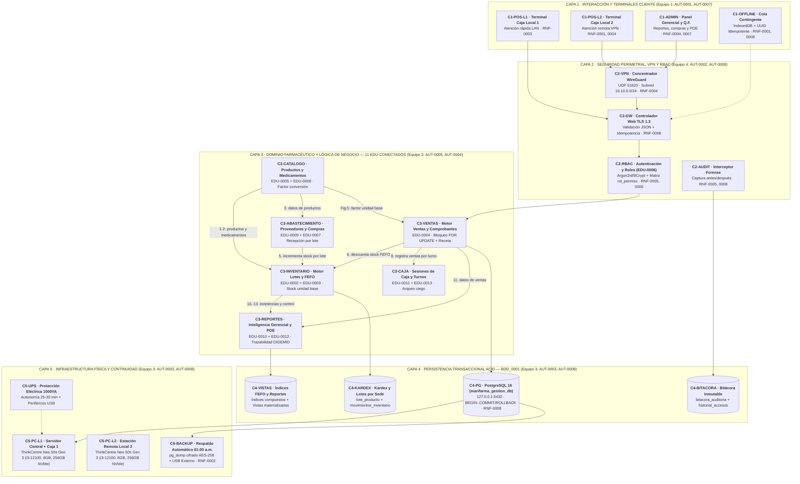

# Innofarma — Arquitectura de Software Definitiva (`ASW-0001 V01.00`) y Visor Interactivo

Suite interactiva de Arquitectura de Software del sistema **Innofarma** para **Botica Marifarma** (Universidad Nacional de San Agustín — UNSA • EPIS • Curso: *Diseño y Arquitectura de Software* • Semestre 2026-B).

---

## 🌐 Ver en vivo (GitHub Pages)

👉 **[Abrir Visor Interactivo Principal (`index.html`)](https://jperezh04.github.io/innofarma-arquitectura/)**

### 🏛️ 0. Arquitectura Final Definitiva (`ASW-0001 V01.00`) — Con Zoom Semántico en 3 Niveles y Semántica Relacional
- **[0.1 Arquitectura en 5 Capas (CR → RF, RNF, Fortalezas y Riesgos)](https://jperezh04.github.io/innofarma-arquitectura/#fig0_1_asw_capas_definitiva.html)**  
  *(Zoom Semántico Progresivo: `1. Lejos Esqueleto` → `2. Medio Píldoras CR` → `3. Cerca Detalle Total` + 25 relaciones dirigidas + filtro por los 4 equipos + evolución `V00.01 → V01.00`)*
- **[0.2 Contexto Modular Nivel 2 (11 Módulos `EDU` Conectados)](https://jperezh04.github.io/innofarma-arquitectura/#fig0_2_asw_contexto_modular_zoom.html)**  
  *(Interconexión funcional de los 11 módulos `EDU` alrededor de `EDU-0002` Inventario y `EDU-0004` Ventas con las 16 relaciones oficiales del curso)*
- **[0.3 Contexto Global (Nivel 0 Caja Negra) + Máquinas de Estados (`DES`)](https://jperezh04.github.io/innofarma-arquitectura/#fig0_3_asw_contexto_global_n0.html)**  
  *(Frontera del sistema con los 6 actores perimetrales y autómatas finitos `DES-0001` Venta y `DES-0002` Producto/Lote)*
- 📄 **[Documento Guía y Evolución en Markdown (`ARQUITECTURA_FINAL_ASW_0001.md`)](./ARQUITECTURA_FINAL_ASW_0001.md)**

### 📐 Vistas Arquitectónicas del Modelo 4+1 (Anexos)
- **1. Vista Física Oficial (`V01.00`):** [fig5_1_vista_fisica_despliegue.html](https://jperezh04.github.io/innofarma-arquitectura/#fig5_1_vista_fisica_despliegue.html)
- **2. Vista Lógica Oficial (`V01.00`):** [fig3_1_interconexion_modulos.html](https://jperezh04.github.io/innofarma-arquitectura/#fig3_1_interconexion_modulos.html)
- **3. Vista de Procesos BPMN 2.0:** [fig4_1_bpmn_proceso_venta.html](https://jperezh04.github.io/innofarma-arquitectura/#fig4_1_bpmn_proceso_venta.html)

---

## 👥 Repartición del Equipo de Arquitectura (4 Equipos de 2 Integrantes)

| Equipo | Integrantes y Códigos `AUT` | Responsabilidad en la Arquitectura `ASW-0001` |
| :--- | :--- | :--- |
| **Equipo 1** | • **Taylor Betanzos Rosas** (`AUT-0001`) • **Joshua Orbegozo Lescano** (`AUT-0007`) | **Contexto Global (Nivel 0)** y **Capa 1 — Interacción y Clientes Web** (`C1-POS-L1`, `C1-POS-L2`, `C1-ADMIN`, `C1-OFFLINE` · `RNF-0003`, `RNF-0004`). |
| **Equipo 2** | • **Ronald García Valdivia** (`AUT-0005`) • **Sebastian Diaz Ticona** (`AUT-0004`) | **Capa 3 — Núcleo de Dominio (11 `EDU`)**, **Contexto Modular (Nivel 2)** y **Máquinas de Estados** (`DES-0001` Venta, `DES-0002` Producto/Lote). |
| **Equipo 3** | • **Joel Condori Leon** (`AUT-0003`) • **Cristian Saya Vargas** (`AUT-0008`) | **Capa 4 — Persistencia Transaccional ACID (`BDD_0001` PostgreSQL 16)** y **Capa 5 — Infraestructura Física y Respaldo** (`2x Lenovo ThinkCentre i3-12100`, `UPS 1000VA`, `pg_dump` · `RNF-0001`, `RNF-0002`, `RNF-0008`). |
| **Equipo 4** | • **Gabriela Borda Espinoza** (`AUT-0002`) • **Jeremy Perez Huamani** (`AUT-0006`) | **Capa 2 — Seguridad Perimetral, VPN WireGuard y Control RBAC** (`EDU-0006` · `RNF-0004`, `RNF-0005`, `RNF-0006`), **Matriz de Riesgos `MRI`** e Integración General (`V00.01 → V01.00`). |

---

## 🔗 Esquema General en Mermaid (Con Enlaces Directos al Visor)

---

## 📂 Catálogo Completo de Archivos del Repositorio

| Archivo | Vista / Módulo | Descripción |
|---|---|---|
| [`index.html`](./index.html) | **Visor Maestro Principal** | Panel lateral jerárquico con buscador, filtro por `EDU`/`ILA` y **Semántica Relacional interactiva** |
| [`fig0_1_asw_capas_definitiva.html`](./fig0_1_asw_capas_definitiva.html) | **`0.1` Arquitectura en 5 Capas (Oficial)** | Arquitectura definitiva `ASW-0001-N1` con Zoom Semántico de 3 niveles, 25 relaciones, RF, RNF, Fortalezas, Riesgos `MRI` y puntos en revisión (`R1`–`R6`) |
| [`fig0_2_asw_contexto_modular_zoom.html`](./fig0_2_asw_contexto_modular_zoom.html) | **`0.2` Contexto Modular Nivel 2** | Interconexión funcional de los 11 módulos `EDU` con las 16 relaciones oficiales del curso y `Figura 5` |
| [`fig0_3_asw_contexto_global_n0.html`](./fig0_3_asw_contexto_global_n0.html) | **`0.3` Contexto Global (N0) + Estados** | Frontera de Caja Negra de Innofarma + Máquinas de Estados `DES-0001` (Venta) y `DES-0002` (Producto/Lote) |
| [`ARQUITECTURA_FINAL_ASW_0001.md`](./ARQUITECTURA_FINAL_ASW_0001.md) | **Guía de Arquitectura y Evolución** | Documento explicativo con repartición en 4 equipos (`AUT-0001..0008`), evolución `V00.01 → V01.00`, desglose por capas y puntos en revisión |
| [`fig5_1_vista_fisica_despliegue.html`](./fig5_1_vista_fisica_despliegue.html) | **1. Vista Física (Oficial)** | Arquitectura de despliegue de 2 locales, Admin remota y túneles WireGuard |
| [`fig5_2_flujo_modo_offline.html`](./fig5_2_flujo_modo_offline.html) | 1. Vista Física (Anexo) | Flujo operativo en modo offline y stock segmentado (`IndexedDB` / `Dexie.js`) |
| [`fig5_3_secuencia_sincronizacion.html`](./fig5_3_secuencia_sincronizacion.html) | 1. Vista Física (Anexo) | Secuencia de sincronización e idempotencia post-corte (`UUID v4`) |
| [`fig5_4_secuencia_acceso_remoto.html`](./fig5_4_secuencia_acceso_remoto.html) | 1. Vista Física (Anexo) | Secuencia de acceso remoto seguro de la Administradora (`WireGuard QR`) |
| [`fig5_5_comparativa_arquitecturas.html`](./fig5_5_comparativa_arquitecturas.html) | 1. Vista Física (Anexo) | Comparativa arquitectónica: Servidor Local vs Nube |
| [`fig3_1_interconexion_modulos.html`](./fig3_1_interconexion_modulos.html) | **2. Vista Lógica (Oficial)** | Diagrama de clases y relaciones de dominio (`EDU-0002` a `EDU-0013`) |
| [`fig1_1_arquitectura_generica.html`](./fig1_1_arquitectura_generica.html) | 2. Vista Lógica (Anexo) | Arquitectura genérica modular en 5 capas |
| [`fig4_1_bpmn_proceso_venta.html`](./fig4_1_bpmn_proceso_venta.html) | **3. Vista de Procesos (BPMN)** | Orquestación global de venta en mostrador (BPMN 2.0 en 5 carriles) |
| [`fig4_2_secuencia_proceso_venta.html`](./fig4_2_secuencia_proceso_venta.html) | `EDU-0004` / `ILA-0005` | Venta transaccional y bloqueo pesimista FEFO (`SELECT FOR UPDATE`) |
| [`fig4_8_secuencia_idempotencia_wan.html`](./fig4_8_secuencia_idempotencia_wan.html) | `EDU-0004` / `ILA-0008` | Manejo de idempotencia ante reintentos WAN (`UUID v4`) |
| [`fig4_7_secuencia_anulacion_venta.html`](./fig4_7_secuencia_anulacion_venta.html) | `EDU-0004` / `ILA-0006, 0007` | Anulación de venta, reversión al lote original y compensación en caja |
| [`fig4_5_secuencia_inventario_fefo.html`](./fig4_5_secuencia_inventario_fefo.html) | `EDU-0002` / `ILA-0001` | Ingreso de lotes y validación sanitaria de caducidad (>180 días) |
| [`fig4_9_secuencia_busqueda_fefo.html`](./fig4_9_secuencia_busqueda_fefo.html) | `EDU-0002` / `ILA-0002` | Búsqueda indexada FEFO por sucursal (`Index Scan`) |
| [`fig4_4_secuencia_catalogo_medicamentos.html`](./fig4_4_secuencia_catalogo_medicamentos.html) | `EDU-0005, 0008` / `ILA-0009, 0021` | Catálogo DIGEMID y factores de fraccionamiento (caja / blíster / unidad) |
| [`fig4_6_secuencia_caja_arqueo.html`](./fig4_6_secuencia_caja_arqueo.html) | `EDU-0011` / `ILA-0033, 0035` | Apertura de sesión de caja y arqueo ciego de turno |
| [`fig4_3_secuencia_control_rbac.html`](./fig4_3_secuencia_control_rbac.html) | `EDU-0006` / `ILA-0013..0015` | Autenticación (`Argon2id`), middleware RBAC y auditoría |
